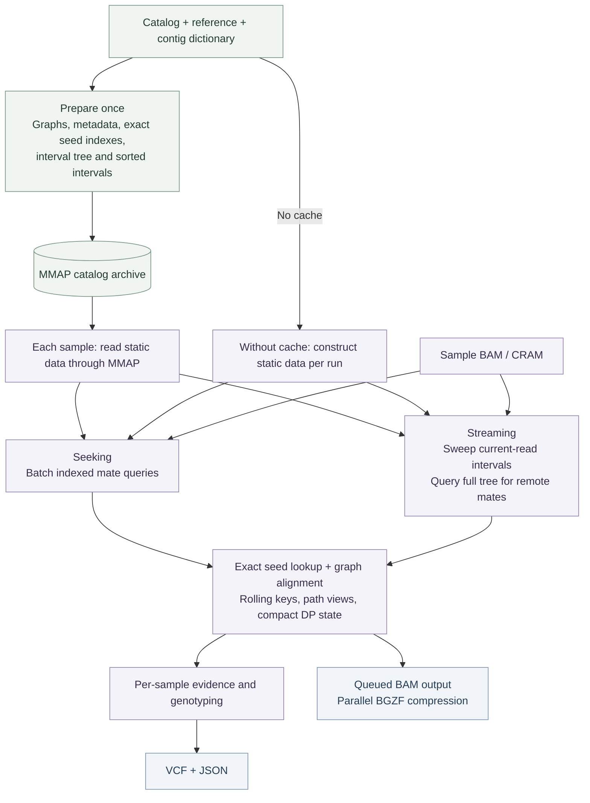

<div align="center">

# NuExpansionHunter

**Estimate short tandem repeat sizes from paired-end whole-genome sequencing data.**

<a id="contents"></a>

<p align="center">
  <a href="#quick-start">Quick start</a> &nbsp;·&nbsp;
  <a href="#usage-and-parameters">Usage</a> &nbsp;·&nbsp;
  <a href="#implementation-status-and-roadmap">Implementation Status and Roadmap</a> &nbsp;·&nbsp;
  <a href="#benchmarks">Benchmarks</a>
  <br>
  <a href="#ai-use-and-review">AI use and review</a> &nbsp;·&nbsp;
  <a href="#questions-and-contributions">Questions and contributions</a> &nbsp;·&nbsp;
  <a href="#acknowledgments-and-references">References</a>
</p>

</div>

---

NuExpansionHunter builds on [Illumina ExpansionHunter v5.0.0](https://github.com/Illumina/ExpansionHunter/tree/v5.0.0). It retains EH's genotyping logic and reduces work in mate retrieval, graph alignment, seed lookup, and BAM compression. An optional memory-mapped catalog cache lets samples reuse graphs, metadata, and indexes prepared once for the same catalog and reference. Read evidence, mate caches, and alignment workspaces remain separate for each sample.

> [!IMPORTANT]
> Use **PCR-free whole-genome sequencing data**, the **reference used to align the reads**, and a **catalog for that assembly**.

<a id="quick-start"></a>

## Quick start <sup><sub>[↑ Contents](#contents)</sub></sup>

The executable is still named `ExpansionHunter`.

<a id="build"></a>

<details>
<summary><strong>Build from source</strong></summary>

Requires **CMake 3.13+**, a **C++11 compiler**, **Git**, and development libraries for **zlib, bzip2, xz, and curl**. The build downloads pinned dependencies and needs internet access. GCC builds use the shared C++ runtime.

From this checkout:

```sh
cmake -S . -B build/release -DCMAKE_BUILD_TYPE=Release
cmake --build build/release -j 8
(cd build/release/ehunter-prefix/src/ehunter-build && ctest --output-on-failure)
```

The executable is `build/release/install/bin/ExpansionHunter`.

The tested Linux build uses GCC 11.5.0. This source includes the same dependency and compiler fixes used in the benchmark; see [build notes](BENCHMARKS.md#build-notes). Builds on other platforms remain on the roadmap.

</details>

### 1. Run the example <sup><sub>[↑ Contents](#contents)</sub></sup>

With `ExpansionHunter` on your `PATH`, run from the repository root:

```sh
mkdir -p results

ExpansionHunter \
  --reads example/input/variants.bam \
  --reference example/input/reference.fa \
  --variant-catalog example/input/variants.json \
  --output-prefix results/example
```

This writes `example.vcf`, `example.json`, and `example_realigned.bam` under `results/`.

### 2. Analyze a human sample <sup><sub>[↑ Contents](#contents)</sub></sup>

Supply coordinate-sorted, indexed BAM or CRAM input. Set `--sex` for the sample and choose a matching catalog from [variant_catalog/](variant_catalog/).

```sh
mkdir -p results

ExpansionHunter \
  --reads sample.bam \
  --reference GRCh38.fa \
  --variant-catalog variant_catalog/hg38/variant_catalog.json \
  --output-prefix results/sample \
  --sex male \
  --analysis-mode seeking \
  --threads 8
```

<a id="catalog-cache"></a>

### 3. Reuse a catalog across samples <sup><sub>[↑ Contents](#contents)</sub></sup>

Prepare a cache once using the same reference, catalog, and BAM contig dictionary as the samples you will analyze:

```sh
ExpansionHunter \
  --reads sample.bam \
  --reference GRCh38.fa \
  --variant-catalog variant_catalog/hg38/variant_catalog.json \
  --output-prefix results/catalog-preparation \
  --catalog-cache results/catalog.ki \
  --prepare-catalog-cache
```

Preparation exits before processing reads. Then add `--catalog-cache results/catalog.ki` to each sample's usual command. Keep the reference and catalog arguments: the program checks them against the cache. Use a new cache filename when rebuilding; preparation does not overwrite an existing file. Without `--catalog-cache`, the usual command still builds catalog data in memory.

<a id="usage-and-parameters"></a>

## Usage and parameters <sup><sub>[↑ Contents](#contents)</sub></sup>

<details>
<summary><strong>Modes and options</strong></summary>

**Seeking** queries indexed regions for each locus and suits small catalogs. **Streaming** reads the alignment file once for all loci, accepts unsorted or unindexed input, and uses more memory as the catalog grows.

| Option | Default | Use |
| :--- | :--- | :--- |
| `--reads` | Required | BAM or CRAM containing aligned reads |
| `--reference` | Required | Matching reference FASTA |
| `--variant-catalog` | Required | JSON catalog of loci to genotype |
| `--output-prefix` | Required | Output path prefix; create its parent directory first |
| `--analysis-mode` | `seeking` | `seeking` or `streaming` |
| `--threads` | `1` | Number of analysis threads |
| `--sex` | `female` | `male` or `female`; sets ploidy on sex chromosomes |
| `--region-extension-length` | `1000` | Bases searched around on-target and off-target regions |
| `--aligner` | `dag-aligner` | `dag-aligner` or `path-aligner` |
| `--log-level` | `info` | `trace`, `debug`, `info`, `warn`, or `error` |
| `--catalog-cache` | None | Read static catalog data from a prepared memory-mapped archive |
| `--prepare-catalog-cache` | Off | Build the specified cache and exit before processing reads |

Use `ExpansionHunter --help` for the public options and `ExpansionHunter --version` for the version.

</details>

<details>
<summary><strong>Variant catalogs</strong></summary>

A catalog is a JSON array of locus definitions. Coordinates are **0-based, half-open**: `chrom:start-end`. Contig names and coordinates must match the reference. For example, the bundled hg38 DMPK entry is:

```json
[
  {
    "LocusId": "DMPK",
    "LocusStructure": "(CAG)*",
    "ReferenceRegion": "chr19:45770204-45770264",
    "VariantType": "Repeat"
  }
]
```

| Field | Meaning |
| :--- | :--- |
| `LocusId` | Unique locus identifier |
| `LocusStructure` | Repeat units, interruptions, and other variants in their sequence order |
| `ReferenceRegion` | Reference interval for each variant |
| `VariantType` | `Repeat`, `RareRepeat`, or `SmallVariant`; `SMN` is a specialized small-variant type |
| `VariantId` | Optional variant identifier; defaults to the locus ID for one variant or `<LocusId>_<ReferenceRegion>` for multiple variants |
| `OfftargetRegions` | Regions where informative reads may misalign; used with `RareRepeat` |

For multiple variants, supply corresponding `ReferenceRegion`, `VariantType`, and optional `VariantId` arrays in the same order. Literal DNA can separate variants, as in `(CAG)*CAACAG(CCG)*`.

| Structure | Meaning |
| :--- | :--- |
| `(CCG)*` | Zero or more repeat copies |
| `(CCG)+` | One or more repeat copies |
| `(C\|T)` | Single-base substitution |
| `(CAGT\|CGTTG)` | Sequence swap |
| `(CTGGC)?` | Insertion or deletion |

`Repeat` calls are limited by fragment length; estimates near that length can be lower bounds. `RareRepeat` enables additional evidence for expansions beyond fragment length and assumes there are no other long repeats with the same unit elsewhere in the genome. Use that type only when the locus supports this assumption.

See the [bundled human catalogs](variant_catalog/) and [small-variant example](example/input/variants.json) for complete definitions.

</details>

<details>
<summary><strong>Outputs and field reference</strong></summary>

| Output | Contents |
| :--- | :--- |
| `.vcf` | Genotypes, repeat sizes, confidence intervals, and read support |
| `.json` | Sample parameters and results grouped by locus |
| `_realigned.bam` | Reads aligned to the locus graphs, with graph-alignment tags |

**VCF.** Repeat alleles use `<STRn>`, where `n` is the repeat-copy count. The file header defines each field.

| Field | Meaning |
| :--- | :--- |
| `RU`, `REF`, `RL` | Repeat unit, reference copy count, and reference length in bases |
| `REPID`, `VARID` | Catalog repeat and variant identifiers |
| `GT`, `REPCN`, `REPCI` | Genotype, repeat-copy counts, and confidence intervals |
| `SO` | Supporting read class: `SPANNING`, `FLANKING`, or `INREPEAT` |
| `ADSP`, `ADFL`, `ADIR` | Supporting spanning, flanking, and in-repeat read counts |
| `LC` | Estimated locus coverage |
| `LowDepth` | Locus depth below 10× or fewer than five reads spanning one or both breakends |

**JSON.** `SampleParameters` contains `SampleId` and `Sex`. Each `LocusResults` entry contains `LocusId`, `Coverage`, `ReadLength`, `FragmentLength`, `AlleleCount`, and available `Variants`.

Repeat records include `RepeatUnit`, `VariantType`, `VariantSubtype`, `ReferenceRegion`, and summaries in `CountsOfSpanningReads`, `CountsOfFlankingReads`, and `CountsOfInrepeatReads`. These summaries are encoded as strings of `(repeat units, read count)` pairs. `Genotype` and `GenotypeConfidenceInterval` appear when a genotype is available.

Small-variant records include `CountOfRefReads`, `CountOfAltReads`, allele-presence statuses and likelihood ratios, and an optional `Genotype`. Their genotypes use `0` and `1` for reference and alternate alleles.

**BAM.** The `XG` tag stores the locus-graph alignment. Record order can vary with parallel execution; the program does not coordinate-sort this output.

See [JsonWriter.cpp](ehunter/io/JsonWriter.cpp), [VcfHeader.cpp](ehunter/io/VcfHeader.cpp), and [BamletWriter.cpp](ehunter/io/BamletWriter.cpp) for the field definitions.

</details>

<a id="implementation-status-and-roadmap"></a>

## Implementation Status and Roadmap <sup><sub>[↑ Contents](#contents)</sub></sup>

NuExpansionHunter retains EH's genotyping model and reduces repeated catalog construction, seed lookup, alignment memory, and output overhead.

### MMAP catalog reuse

Graphs, sequences, metadata, 10/14-mer indexes, and interval indexes are prepared once and stored in an offset-based archive. Each sample reads these arrays directly through a read-only **memory map (MMAP)**, without reconstructing the catalog's strings, paths, and indexes as heap objects. Read evidence, mate caches, and alignment workspaces remain separate for each sample.

The archive can be reused across samples with the same catalog, reference, contig dictionary, index settings, and builder version. MMAP avoids repeated construction and allows the operating system to manage file-backed pages; it does not impose a fixed RAM limit. See [cache usage](#catalog-cache) and [implementation](ehunter/io/PreparedCatalog.cpp).

### Compact, exact k-mer lookup

The 10-mer orientation index stores membership keys only. The 14-mer alignment index stores path coordinates and node IDs in flat arrays, with short single-node paths packed into two 16-bit fields. Rolling two-bit encoding avoids re-encoding overlapping read substrings, and path views construct only the requested paths. All matching paths and their multiplicities are retained. See [KmerIndex.cpp](ehunter/thirdparty/graph-tools-master-f421f4c/src/graphalign/KmerIndex.cpp).

### Coordinate-ordered interval lookup

A sweep advances through sorted extraction intervals as reads move along the genome, checking the active intervals for each read. Remote mates and backward-moving reads still use the full interval tree, including off-target regions. The sweep preserves matching order and duplicates and does not discard locus evidence. See [AnalyzerFinder.cpp](ehunter/sample/AnalyzerFinder.cpp).

### Smaller alignment state and fewer read copies

The affine-gap aligner reuses temporary score rows and stores insertion traceback decisions as one bit per cell, preserving the original scores and traceback. Streaming queues are allocated on activation and released when empty; recovered mates transfer their sequence buffers instead of copying them. See [alignment storage](ehunter/thirdparty/graph-tools-master-f421f4c/include/graphalign/dagAligner/AffineAlignMatrixVectorized.hh) and [streaming collection](ehunter/sample/HtsStreamingSampleAnalysis.cpp).

### Batched mate retrieval and parallel BAM output

Seeking mode batches indexed mate-region queries and restores the original read-pair order. Realigned BAM output uses a writer queue and parallel BGZF compression, with write and close failures propagated to the caller. See [mate retrieval](ehunter/sample/MateExtractor.cpp) and [BAM output](ehunter/io/BamletWriter.cpp).

### Processing flow



### Roadmap

- Reduce per-sample processing time and investigate the 8-core performance difference.
- Further compact seed and path storage for larger catalogs.
- Extend output-equivalence checks to more samples, catalogs, and large expansions.
- Improve build portability and complete the human code audit.

<a id="benchmarks"></a>

## Benchmarks <sup><sub>[↑ Contents](#contents)</sub></sup>

We benchmarked NuExpansionHunter on the complete **HG002 Illumina PCR-free WGS dataset** using the **174,293-locus Illumina hg38 catalog** on Brown Oscar.

| Physical cores | Runtime, original EH → NuExpansionHunter | Speedup | CPU-hours saved | Peak RSS, original → optimized |
| ---: | ---: | ---: | ---: | ---: |
| 4 | 3295.60 → 2240.79 s | 1.471× | 32.01% | 15.338 → 15.196 GiB |
| 8 | 1703.73 → 1348.26 s | 1.264× | 20.86% | 15.681 → 15.194 GiB |
| 16 | 1248.94 → 703.92 s | 1.774× | 43.64% | 29.584 → 15.207 GiB |
| 32 | 1064.28 → 489.48 s | 2.174× | 54.01% | 35.956 → 15.215 GiB |

The 32-core full HG002 output matched original EH: VCF/JSON byte-identical and BAM content identical ignoring record order. Original timings are from earlier runs; one-time cache preparation is excluded. See [benchmark methods and validation](BENCHMARKS.md) for details.

<a id="ai-use-and-review"></a>

## AI use and review <sup><sub>[↑ Contents](#contents)</sub></sup>

| Item | Status |
| :--- | :--- |
| AI use | Assisted refactoring, tests, and documentation |
| Comprehensive human audit | Pending |

<a id="questions-and-contributions"></a>

## Questions and contributions <sup><sub>[↑ Contents](#contents)</sub></sup>

Visit [BioCode Commons](https://biocode-commons.github.io/) for projects, contribution guidance, and contact information.

<a id="acknowledgments-and-references"></a>

## Acknowledgments and references <sup><sub>[↑ Contents](#contents)</sub></sup>

ExpansionHunter was developed by Egor Dolzhenko and collaborators at Illumina and partner institutions. This fork builds on their [original source code](https://github.com/Illumina/ExpansionHunter/tree/v5.0.0). Please cite the original work:

- [Repeat expansion detection](https://doi.org/10.1101/gr.225672.117). Dolzhenko et al., *Genome Research*, 2017.
- [Sequence graph method](https://doi.org/10.1093/bioinformatics/btz431). Dolzhenko et al., *Bioinformatics*, 2019.

<details>
<summary><strong>BibTeX references</strong></summary>

```bibtex
@article{Dolzhenko2017ExpansionHunter,
  author  = {Dolzhenko, Egor and van Vugt, Joke J. F. A. and Shaw, Richard J. and others},
  title   = {Detection of long repeat expansions from {PCR}-free whole-genome sequence data},
  journal = {Genome Research},
  year    = {2017},
  volume  = {27},
  number  = {11},
  pages   = {1895--1903},
  doi     = {10.1101/gr.225672.117}
}

@article{Dolzhenko2019ExpansionHunter,
  author  = {Dolzhenko, Egor and Deshpande, Viraj and Schlesinger, Felix and others},
  title   = {{ExpansionHunter}: a sequence-graph-based tool to analyze variation in short tandem repeat regions},
  journal = {Bioinformatics},
  year    = {2019},
  volume  = {35},
  number  = {22},
  pages   = {4754--4756},
  doi     = {10.1093/bioinformatics/btz431}
}
```

</details>

Licensed under [Apache 2.0](LICENSE.txt). Upstream attribution and third-party notices remain in [COPYRIGHT.txt](COPYRIGHT.txt).
