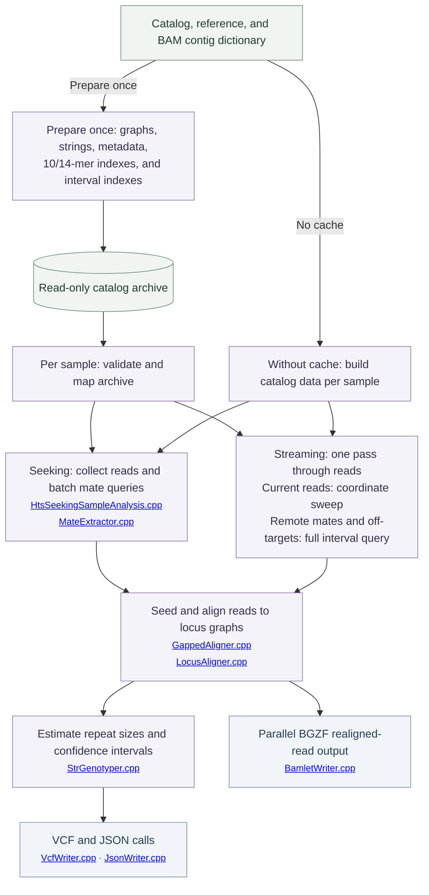

<div align="center">

# NuExpansionHunter

**Estimate short tandem repeat sizes from paired-end whole-genome sequencing data.**

<a id="contents"></a>

<p align="center">
  <a href="#quick-start">Quick start</a> &nbsp;·&nbsp;
  <a href="#usage-and-parameters">Usage</a> &nbsp;·&nbsp;
  <a href="#implementation-status-and-roadmap">Implementation Status and Roadmap</a> &nbsp;·&nbsp;
  <a href="#benchmarks">Benchmarks</a>
  <br>
  <a href="#ai-use-and-review">AI use and review</a> &nbsp;·&nbsp;
  <a href="#questions-and-contributions">Questions and contributions</a> &nbsp;·&nbsp;
  <a href="#acknowledgments-and-references">References</a>
</p>

</div>

---

NuExpansionHunter builds on [Illumina ExpansionHunter v5.0.0](https://github.com/Illumina/ExpansionHunter/tree/v5.0.0). It retains EH's genotyping logic and reduces work in mate retrieval, graph alignment, seed lookup, and BAM compression. An optional memory-mapped catalog cache lets samples reuse graphs, metadata, and indexes prepared once for the same catalog and reference. Read evidence, mate caches, and alignment workspaces remain separate for each sample.

The previous version passed full HG002 output comparisons at 4, 8, 16, and 32 cores. The new catalog-cache and interval-query changes have passed unit tests, subset output checks, and a complete HG002 output comparison at 32 cores. The latest timings use saved original-EH measurements; see [benchmarks](#benchmarks) for results and the validation scope at each core count.

> [!IMPORTANT]
> Use **PCR-free whole-genome sequencing data**, the **reference used to align the reads**, and a **catalog for that assembly**.

<a id="quick-start"></a>

## Quick start <sup><sub>[↑ Contents](#contents)</sub></sup>

The executable is still named `ExpansionHunter`.

<a id="build"></a>

<details>
<summary><strong>Build from source</strong></summary>

Requires **CMake 3.13+**, a **C++11 compiler**, **Git**, and development libraries for **zlib, bzip2, xz, and curl**. The build downloads pinned dependencies and needs internet access. GCC builds use the shared C++ runtime.

From this checkout:

```sh
cmake -S . -B build/release -DCMAKE_BUILD_TYPE=Release
cmake --build build/release -j 8
(cd build/release/ehunter-prefix/src/ehunter-build && ctest --output-on-failure)
```

The executable is `build/release/install/bin/ExpansionHunter`.

The tested Linux build uses GCC 11.5.0. This source includes the same dependency and compiler fixes used in the benchmark; see [build notes](BENCHMARKS.md#build-notes). Builds on other platforms remain on the roadmap.

</details>

### 1. Run the example <sup><sub>[↑ Contents](#contents)</sub></sup>

With `ExpansionHunter` on your `PATH`, run from the repository root:

```sh
mkdir -p results

ExpansionHunter \
  --reads example/input/variants.bam \
  --reference example/input/reference.fa \
  --variant-catalog example/input/variants.json \
  --output-prefix results/example
```

This writes `example.vcf`, `example.json`, and `example_realigned.bam` under `results/`.

### 2. Analyze a human sample <sup><sub>[↑ Contents](#contents)</sub></sup>

Supply coordinate-sorted, indexed BAM or CRAM input. Set `--sex` for the sample and choose a matching catalog from [variant_catalog/](variant_catalog/).

```sh
mkdir -p results

ExpansionHunter \
  --reads sample.bam \
  --reference GRCh38.fa \
  --variant-catalog variant_catalog/hg38/variant_catalog.json \
  --output-prefix results/sample \
  --sex male \
  --analysis-mode seeking \
  --threads 8
```

<a id="catalog-cache"></a>

### 3. Reuse a catalog across samples <sup><sub>[↑ Contents](#contents)</sub></sup>

Prepare a cache once using the same reference, catalog, and BAM contig dictionary as the samples you will analyze:

```sh
ExpansionHunter \
  --reads sample.bam \
  --reference GRCh38.fa \
  --variant-catalog variant_catalog/hg38/variant_catalog.json \
  --output-prefix results/catalog-preparation \
  --catalog-cache results/catalog.ki \
  --prepare-catalog-cache
```

Preparation exits before processing reads. Then add `--catalog-cache results/catalog.ki` to each sample's usual command. Keep the reference and catalog arguments: the program checks them against the cache. Use a new cache filename when rebuilding; preparation does not overwrite an existing file. Without `--catalog-cache`, the usual command still builds catalog data in memory.

<a id="usage-and-parameters"></a>

## Usage and parameters <sup><sub>[↑ Contents](#contents)</sub></sup>

<details>
<summary><strong>Modes and options</strong></summary>

**Seeking** queries indexed regions for each locus and suits small catalogs. **Streaming** reads the alignment file once for all loci, accepts unsorted or unindexed input, and uses more memory as the catalog grows.

| Option | Default | Use |
| :--- | :--- | :--- |
| `--reads` | Required | BAM or CRAM containing aligned reads |
| `--reference` | Required | Matching reference FASTA |
| `--variant-catalog` | Required | JSON catalog of loci to genotype |
| `--output-prefix` | Required | Output path prefix; create its parent directory first |
| `--analysis-mode` | `seeking` | `seeking` or `streaming` |
| `--threads` | `1` | Number of analysis threads |
| `--sex` | `female` | `male` or `female`; sets ploidy on sex chromosomes |
| `--region-extension-length` | `1000` | Bases searched around on-target and off-target regions |
| `--aligner` | `dag-aligner` | `dag-aligner` or `path-aligner` |
| `--log-level` | `info` | `trace`, `debug`, `info`, `warn`, or `error` |
| `--catalog-cache` | None | Read static catalog data from a prepared memory-mapped archive |
| `--prepare-catalog-cache` | Off | Build the specified cache and exit before processing reads |

Use `ExpansionHunter --help` for the public options and `ExpansionHunter --version` for the version.

</details>

<details>
<summary><strong>Variant catalogs</strong></summary>

A catalog is a JSON array of locus definitions. Coordinates are **0-based, half-open**: `chrom:start-end`. Contig names and coordinates must match the reference. For example, the bundled hg38 DMPK entry is:

```json
[
  {
    "LocusId": "DMPK",
    "LocusStructure": "(CAG)*",
    "ReferenceRegion": "chr19:45770204-45770264",
    "VariantType": "Repeat"
  }
]
```

| Field | Meaning |
| :--- | :--- |
| `LocusId` | Unique locus identifier |
| `LocusStructure` | Repeat units, interruptions, and other variants in their sequence order |
| `ReferenceRegion` | Reference interval for each variant |
| `VariantType` | `Repeat`, `RareRepeat`, or `SmallVariant`; `SMN` is a specialized small-variant type |
| `VariantId` | Optional variant identifier; defaults to the locus ID for one variant or `<LocusId>_<ReferenceRegion>` for multiple variants |
| `OfftargetRegions` | Regions where informative reads may misalign; used with `RareRepeat` |

For multiple variants, supply corresponding `ReferenceRegion`, `VariantType`, and optional `VariantId` arrays in the same order. Literal DNA can separate variants, as in `(CAG)*CAACAG(CCG)*`.

| Structure | Meaning |
| :--- | :--- |
| `(CCG)*` | Zero or more repeat copies |
| `(CCG)+` | One or more repeat copies |
| `(C\|T)` | Single-base substitution |
| `(CAGT\|CGTTG)` | Sequence swap |
| `(CTGGC)?` | Insertion or deletion |

`Repeat` calls are limited by fragment length; estimates near that length can be lower bounds. `RareRepeat` enables additional evidence for expansions beyond fragment length and assumes there are no other long repeats with the same unit elsewhere in the genome. Use that type only when the locus supports this assumption.

See the [bundled human catalogs](variant_catalog/) and [small-variant example](example/input/variants.json) for complete definitions.

</details>

<details>
<summary><strong>Outputs and field reference</strong></summary>

| Output | Contents |
| :--- | :--- |
| `.vcf` | Genotypes, repeat sizes, confidence intervals, and read support |
| `.json` | Sample parameters and results grouped by locus |
| `_realigned.bam` | Reads aligned to the locus graphs, with graph-alignment tags |

**VCF.** Repeat alleles use `<STRn>`, where `n` is the repeat-copy count. The file header defines each field.

| Field | Meaning |
| :--- | :--- |
| `RU`, `REF`, `RL` | Repeat unit, reference copy count, and reference length in bases |
| `REPID`, `VARID` | Catalog repeat and variant identifiers |
| `GT`, `REPCN`, `REPCI` | Genotype, repeat-copy counts, and confidence intervals |
| `SO` | Supporting read class: `SPANNING`, `FLANKING`, or `INREPEAT` |
| `ADSP`, `ADFL`, `ADIR` | Supporting spanning, flanking, and in-repeat read counts |
| `LC` | Estimated locus coverage |
| `LowDepth` | Locus depth below 10× or fewer than five reads spanning one or both breakends |

**JSON.** `SampleParameters` contains `SampleId` and `Sex`. Each `LocusResults` entry contains `LocusId`, `Coverage`, `ReadLength`, `FragmentLength`, `AlleleCount`, and available `Variants`.

Repeat records include `RepeatUnit`, `VariantType`, `VariantSubtype`, `ReferenceRegion`, and summaries in `CountsOfSpanningReads`, `CountsOfFlankingReads`, and `CountsOfInrepeatReads`. These summaries are encoded as strings of `(repeat units, read count)` pairs. `Genotype` and `GenotypeConfidenceInterval` appear when a genotype is available.

Small-variant records include `CountOfRefReads`, `CountOfAltReads`, allele-presence statuses and likelihood ratios, and an optional `Genotype`. Their genotypes use `0` and `1` for reference and alternate alleles.

**BAM.** The `XG` tag stores the locus-graph alignment. Record order can vary with parallel execution; the program does not coordinate-sort this output.

See [JsonWriter.cpp](ehunter/io/JsonWriter.cpp), [VcfHeader.cpp](ehunter/io/VcfHeader.cpp), and [BamletWriter.cpp](ehunter/io/BamletWriter.cpp) for the field definitions.

</details>

<a id="implementation-status-and-roadmap"></a>

## Implementation Status and Roadmap <sup><sub>[↑ Contents](#contents)</sub></sup>

NuExpansionHunter separates reusable catalog data from the state collected for each sample. The optional cache stores the reusable data once. Without a cache, the program builds it during each run.

Use the [catalog preparation command](#catalog-cache) to create the cache, then supply `--catalog-cache` for subsequent samples. Reuse requires the same catalog, reference, contig dictionary, and index settings.

The archive holds graphs, sequences and other strings, locus and variant metadata, exact 10-mer membership sets, 14-mer path indexes, and interval indexes. Samples read these arrays directly from a read-only mapping instead of rebuilding them. Evidence, mate caches, alignment workspaces, statistics, and genotypes remain sample-specific. Cache loading checks input fingerprints, the builder source fingerprint, layout, and record checksums; caches must be rebuilt after a source change. Preparation publishes the file only after writing it successfully.

Memory mapping does not impose a fixed RAM limit. Accessed file pages can contribute to resident memory, alongside each sample's mutable state. A larger catalog can therefore increase both cache size and peak RSS. Cache validation also takes time: input fingerprinting and record checksums are part of each sample's loading cost.

For coordinate-sorted reads, the current-read lookup uses an interval sweep. Remote mates still use the complete interval index, including off-target regions. A read that moves backward in coordinate order uses the full query path. The sweep does not evict locus evidence.

The latest changes passed the EH unit suite, all 30 bundled GraphTools tests, and exact output comparisons on the example and the 10,000-read-pair HG002 subset with all 174,293 loci. VCF and JSON matched byte for byte; BAM headers and all record fields, tags, and duplicate counts matched after ignoring record order.

The latest full HG002 runs measured each core count once and compared timing and memory with the saved original-EH results. The 32-core run passed a complete output comparison with retained original-EH outputs. The new 4-, 8-, and 16-core runs completed timing and BAM integrity checks without full-output comparisons. Their validation scope is reported in the benchmark below. The target of less than 300 GB RAM for a 5-million-locus catalog has not been measured.

NuExpansionHunter collects reads, aligns them to locus graphs, and estimates repeat sizes. Seeking and streaming use separate read-collection paths; the full-WGS benchmark exercises streaming. Click a filename to open its implementation.



| Component | Status | What it does |
| :--- | :--- | :--- |
| Batched mate retrieval (seeking) | Implemented; output checks passed | Reads requested intervals together and matches mates by fragment ID and mate number |
| Compact affine-alignment state | Implemented; differential and output checks passed | Reuses match and insertion-score storage and keeps the exact insertion traceback predicate as one bit per cell |
| Rolling encoded seed lookup | Implemented; differential and output checks passed | Avoids repeated substring encoding and materializes only the selected graph path |
| Demand-allocated streaming queues | Implemented; queue and output checks passed | Allocates a per-locus read-pair queue only while that locus is active |
| Streaming mate ownership transfer | Implemented; output checks passed | Moves cached mates out of their container nodes without copying sequence buffers |
| Parallel BGZF output | Implemented; writer and full-WGS checks passed | Compresses the realigned-read BAM in parallel and reports asynchronous write or close failures |
| Initialized BAM padding | Implemented; writer reproducibility checks passed | Initializes packed sequence bytes, including unused bits in odd-length reads |
| Memory-mapped catalog | Implemented; unit, subset, and 32-core full HG002 output checks passed | Reads static graph, string, metadata, seed, and interval arrays directly from a reusable mapping |
| Compact seed storage | Implemented; differential and subset output checks passed | Stores exact 10-mer membership keys and 14-mer path data in flat arrays; materializes a path when needed |
| Coordinate interval sweep | Implemented; query, subset, and 32-core full HG002 output checks passed | Uses read order for current-read lookup and retains full lookup for remote mates and off-target regions |

<details>
<summary><strong>Inside NuExpansionHunter</strong></summary>

- **Catalog reuse:** [PreparedCatalog.cpp](ehunter/io/PreparedCatalog.cpp) writes the static catalog and indexes into one archive. [MappedData.hh](ehunter/thirdparty/graph-tools-master-f421f4c/include/graphutils/MappedData.hh) provides views into its arrays and strings. Locus, graph, and variant handles retain the mapping owner so their data stays valid while in use. Each sample still allocates its own evidence and alignment state.
- **Interval queries:** [AnalyzerFinder.cpp](ehunter/sample/AnalyzerFinder.cpp) reads the prepared interval tree and sorted interval arrays. Its sweep tracks current-read overlap; mate queries use the complete tree. [GenomeMask.cpp](ehunter/sample/GenomeMask.cpp) reads the prepared coarse mask. Target and off-target regions remain in both indexes.
- **Read retrieval (seeking):** `recoverMates()` in [HtsSeekingSampleAnalysis.cpp](ehunter/sample/HtsSeekingSampleAnalysis.cpp) collects mate queries and calls `MateExtractor::extractMates()` in [MateExtractor.cpp](ehunter/sample/MateExtractor.cpp). The method uses `sam_itr_regarray()` to query the union of the original intervals. Matching mates follow input-file order and are returned in the original read-pair order.
- **Streaming collection:** [HtsStreamingSampleAnalysis.cpp](ehunter/sample/HtsStreamingSampleAnalysis.cpp) transfers a cached mate by extracting its container node. [HtsStreamingReadPairQueue.cpp](ehunter/sample/HtsStreamingReadPairQueue.cpp) constructs a locus queue on activation and releases it when empty.
- **Seed lookup:** [OrientationPredictor.cpp](ehunter/alignment/OrientationPredictor.cpp) and [GappedAligner.cpp](ehunter/thirdparty/graph-tools-master-f421f4c/src/graphalign/GappedAligner.cpp) carry rolling two-bit k-mers. [KmerIndex.cpp](ehunter/thirdparty/graph-tools-master-f421f4c/src/graphalign/KmerIndex.cpp) stores membership keys and path records in flat arrays, exposes encoded lookup, and materializes only the selected path. Mapped indexes do not retain the construction maps.
- **Graph alignment:** [AffineAlignMatrixVectorized.hh](ehunter/thirdparty/graph-tools-master-f421f4c/include/graphalign/dagAligner/AffineAlignMatrixVectorized.hh) keeps temporary match and insertion scores in reusable rows. It retains the historical insertion traceback decision in a compact bit matrix; deletion and primary score matrices remain unchanged.
- **BAM output:** [BamletWriter.cpp](ehunter/io/BamletWriter.cpp) initializes packed sequence bytes, starts HTS compression workers before the asynchronous writer, drains queued records after a failure, and explicitly joins and closes the writer so errors reach the main path. The pinned HTSlib patches make setup rollback and asynchronous queue cleanup deterministic.

</details>

| Area | Next work |
| :--- | :--- |
| Benchmark confidence | Repeat paired measurements to quantify run-to-run and node-to-node variation |
| Additional validation | Add samples, sequencing datasets, catalogs, and large-expansion cases |
| Large catalogs | Measure preparation cost, per-sample time, and memory at roughly 5 million loci; the single-process target is below 300 GB RAM |
| Builds | Test additional compilers and platforms and simplify portable source builds |
| Review | Complete the pending comprehensive human audit |

<a id="benchmarks"></a>

## Benchmarks <sup><sub>[↑ Contents](#contents)</sub></sup>

The latest MMAP version processed the complete human **HG002** WGS dataset: **830,172,418 primary reads (415,086,209 pairs)**, using the Illumina **174,293-locus** catalog. Each core count ran once. The original **Illumina ExpansionHunter v5.0.0** timings and memory measurements come from the earlier benchmark; the original was not rerun. CPU-hours are allocated physical cores × wall time.

| Physical cores | Historical original → latest MMAP | Speedup | Allocated CPU-hours saved | Peak RSS, original → MMAP | Latest full output comparison |
| ---: | ---: | ---: | ---: | ---: | :--- |
| 4 | 3295.60 → 2240.79 s | 1.471× | 32.01% | 15.338 → 15.196 GiB (−0.93%) | Not performed |
| 8 | 1703.73 → 1348.26 s | 1.264× | 20.86% | 15.681 → 15.194 GiB (−3.10%) | Not performed |
| 16 | 1248.94 → 703.92 s | 1.774× | 43.64% | 29.584 → 15.207 GiB (−48.60%) | Not performed |
| 32 | 1064.28 → 489.48 s | 2.174× | 54.01% | 35.956 → 15.215 GiB (−57.68%) | **Output identical*** |

\* At 32 cores, VCF and JSON were byte-identical to the retained original outputs. The BAM header and all **74,565,578** records, fields, tags, and duplicate counts matched after ignoring record order. The latest 4/8/16-core runs had BAM integrity checks but no complete output comparison. The previous optimized version passed full output comparisons at all four core counts.

One-time cache preparation took **490.75 seconds** and is excluded from these per-sample times. These comparisons use historical baselines across separate runs and nodes. The latest 8-core run was 7.7% slower than the previous optimized observation, so the results do not show a uniform additional speed improvement from MMAP. See [benchmark details](BENCHMARKS.md) for phase timings, preparation cost, CPU time, RAM, and the historical paired results.

<a id="ai-use-and-review"></a>

## AI use and review <sup><sub>[↑ Contents](#contents)</sub></sup>

| Item | Status |
| :--- | :--- |
| AI use | Assisted refactoring, tests, and documentation |
| Comprehensive human audit | Pending |

<a id="questions-and-contributions"></a>

## Questions and contributions <sup><sub>[↑ Contents](#contents)</sub></sup>

Visit [BioCode Commons](https://biocode-commons.github.io/) for projects, contribution guidance, and contact information.

<a id="acknowledgments-and-references"></a>

## Acknowledgments and references <sup><sub>[↑ Contents](#contents)</sub></sup>

ExpansionHunter was developed by Egor Dolzhenko and collaborators at Illumina and partner institutions. This fork builds on their [original source code](https://github.com/Illumina/ExpansionHunter/tree/v5.0.0). Please cite the original work:

- [Repeat expansion detection](https://doi.org/10.1101/gr.225672.117). Dolzhenko et al., *Genome Research*, 2017.
- [Sequence graph method](https://doi.org/10.1093/bioinformatics/btz431). Dolzhenko et al., *Bioinformatics*, 2019.

<details>
<summary><strong>BibTeX references</strong></summary>

```bibtex
@article{Dolzhenko2017ExpansionHunter,
  author  = {Dolzhenko, Egor and van Vugt, Joke J. F. A. and Shaw, Richard J. and others},
  title   = {Detection of long repeat expansions from {PCR}-free whole-genome sequence data},
  journal = {Genome Research},
  year    = {2017},
  volume  = {27},
  number  = {11},
  pages   = {1895--1903},
  doi     = {10.1101/gr.225672.117}
}

@article{Dolzhenko2019ExpansionHunter,
  author  = {Dolzhenko, Egor and Deshpande, Viraj and Schlesinger, Felix and others},
  title   = {{ExpansionHunter}: a sequence-graph-based tool to analyze variation in short tandem repeat regions},
  journal = {Bioinformatics},
  year    = {2019},
  volume  = {35},
  number  = {22},
  pages   = {4754--4756},
  doi     = {10.1093/bioinformatics/btz431}
}
```

</details>

Licensed under [Apache 2.0](LICENSE.txt). Upstream attribution and third-party notices remain in [COPYRIGHT.txt](COPYRIGHT.txt).
